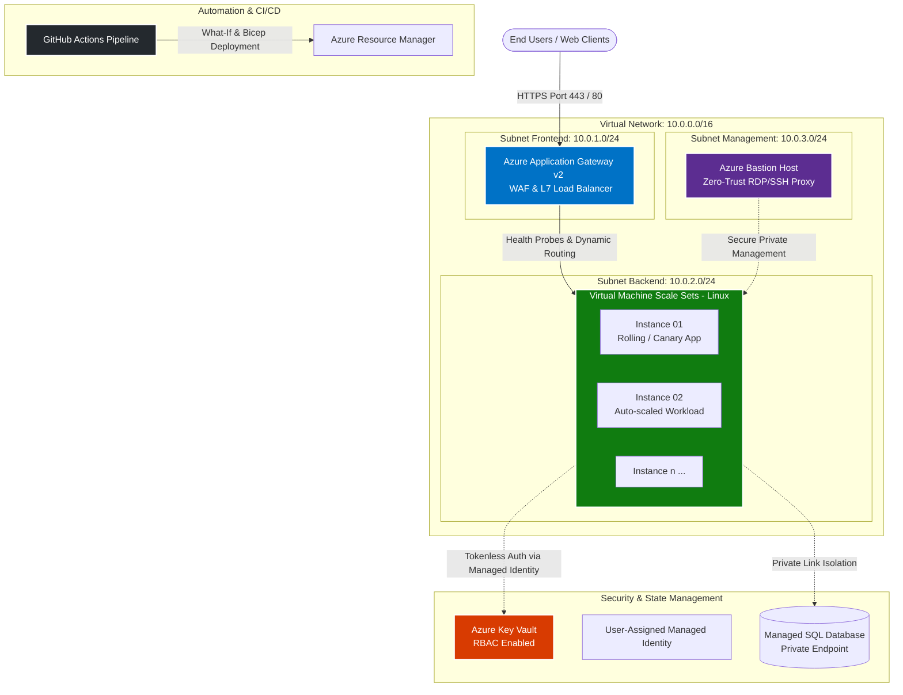

# 🚀 Project Phoenix: Enterprise IaaS Auto-Scaling & Zero-Downtime Architecture

[](https://azure.microsoft.com/)
[](https://learn.microsoft.com/azure/azure-resource-manager/bicep/)
[](https://github.com/features/actions)
[](https://azure.microsoft.com/)
[](https://www.finops.org/)

---

## 📌 Executive Summary
**Project Phoenix** is an enterprise-grade Infrastructure-as-Code (IaC) implementation designed on **Microsoft Azure**. The project models an automated, fault-tolerant, and elastic IaaS topology engineered to handle production workloads with **Zero-Downtime (Blue-Green / Rolling Upgrades)**, strict **Zero-Trust network security**, and horizontal auto-scaling.

Entirely provisioned natively via **Azure Bicep** and enforced by automated governance policies (**Azure Policy**), it showcases true multi-tier enterprise architecture without relying on managed Kubernetes clusters, reflecting real-world financial and enterprise compliance demands.

---

## 🏛️ Architecture Overview



---

## 🔑 Key Engineering Highlights

### 1. Zero-Trust Network Perimeter
* **No Public IPs on Workloads:** Backend virtual machines reside entirely in a private subnet (`10.0.2.0/24`) without direct internet access.
* **Azure Bastion:** Hardened administrative access via HTTPS tunneling, completely eliminating open management ports (22/3389) to the public internet.
* **Web Application Firewall (WAF v2):** Layer 7 deep inspection and automated DDoS mitigation at the ingress tier.

### 2. High Availability & Elasticity
* **Virtual Machine Scale Sets (VMSS):** Dynamic horizontal scaling based on metric telemetry (CPU consumption thresholds: Scale-out at >75%, Scale-in at <30%).
* **Health Probes & Rolling Upgrades:** Continuous health monitoring with automated instance draining, ensuring true zero-downtime during application deployments.

### 3. Identity-Driven Secret Management
* **Managed Identities (Zero Hardcoded Secrets):** VMs dynamically authenticate to **Azure Key Vault** using a User-Assigned Managed Identity with scoped RBAC roles (`Key Vault Secrets User`).
* **In-Memory Injection:** Secrets and connection strings are pulled at boot directly into memory.

### 4. FinOps & Ephemeral Infrastructure
* Automated lifecycle scripts enabling a **"Deploy-Verify-Teardown"** pipeline to maintain full environment test cycles under **$12 USD per run**.
* Strict enforcement of organizational tagging policies (`Environment`, `Owner`, `CostCenter`, `Project`) verified via pre-flight `what-if` checks.

---

## 📂 Repository Structure

```text
project-phoenix/
├── infrastructure/
│   ├── main.bicep                     # Master Orchestrator (Scopes, global parameters, outputs)
│   └── modules/
│       ├── network.bicep              # VNet, Subnets (AppGW, VMSS, Bastion), NSGs
│       ├── bastion.bicep              # Azure Bastion Host + Standard Public IP
│       ├── keyvault.bicep             # Key Vault (RBAC enabled) + Managed Identity + Role Assignment
│       ├── appgateway.bicep          # Application Gateway v2 (WAF, Probes, Listeners, Routing Rules)
│       └── vmss.bicep                 # VM Scale Sets + Autoscaling rules + Custom Script Extensions
├── .github/
│   └── workflows/
│       └── deploy.yml                 # Automated Validation, What-If, and Production Deployment
├── README.md                          # Architecture and project documentation
```

---

## 🚀 Deployment Instructions

### Prerequisites
* Azure CLI (v2.50+)
* Bicep CLI (`az bicep install`)

### 1. Pre-flight Validation (What-If)
```bash
az deployment group what-if \
  --resource-group rg-phoenix-prod-001 \
  --template-file infrastructure/main.bicep
```

### 2. Deploy Infrastructure
```bash
az deployment group create \
  --resource-group rg-phoenix-prod-001 \
  --template-file infrastructure/main.bicep
```

### 3. Teardown (FinOps Lifecycle)
To destroy all resources and prevent ongoing costs:
```bash
az group delete --name rg-phoenix-prod-001 --yes --no-wait
```

---

## 👨‍💻 Author
**Santiago Graciano**
*DevOps & Cloud Infrastructure Engineer*
